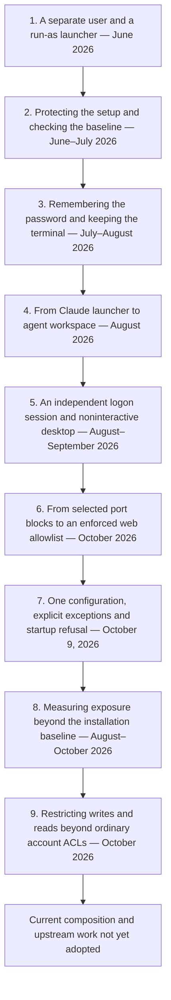

# Project evolution

`agent-win-sandbox` began as a way to run Claude Code under another Windows
user while keeping a native Visual Studio/MSVC workflow. It has grown into a
set of controls for identity, console sessions, filesystem access and network
egress, with diagnostics that test the resulting exposure.

This account follows the repository through commit
[`7d69960` (2026-10-21)](https://github.com/fmuecke/agent-win-sandbox/commit/7d6996060ccbe774046dfc2188bcb3fc1335d3c1),
including the 1.0.0 changelog, and checks dependency history as of 2026-11-11.
Dates below distinguish upstream features from their adoption here. The
[project changelog](CHANGELOG.md) records releases; the Git history fills in
the earlier development and explains why the boundaries changed.

## 1. A separate user and a run-as launcher — June 2026

The first implementation on
[June 25](https://github.com/fmuecke/agent-win-sandbox/commit/bd462a3e3835e3b1daef274d51e3d38c95656028)
was called `claude-win-sandbox`. Setup created the standard local account
`ClaudeSandbox`, granted it Modify access to a shared project directory,
and prepared a Visual Studio Developer Shell. The developer's profile and
credentials stayed under the developer's identity.

Account hardening denied network and RDP logon and hid the account from the
login screen. Local interactive logon remained enabled because the launcher
needed it. These logon restrictions did **not** block outbound connections.

The initial launcher used `Start-Process -Credential`, with `runas.exe` as
a fallback. A same-day
[simplification](https://github.com/fmuecke/agent-win-sandbox/commit/c3cd0cdee3324d9fadae28e8602eaec3c666acc7)
switched to `runas.exe`, which prompted for the password and opened another
console. The source explains the practical reason: the credential-based
Start-Process path could produce a shell that rendered but did not accept
keyboard input.

This was identity separation, not a filesystem allowlist. Granting access to
one workspace did not revoke the account's ordinary access elsewhere. Files
readable by Users, writable shared folders, and network destinations could
still be exposed.

## 2. Protecting the setup and checking the baseline — June–July 2026

Verification was present from the beginning. `Check-ClaudeSandbox.ps1`
checked the account, group memberships, logon rights, workspace permissions,
developer-profile exposure, toolchain and managed policy. Its PASS/WARN/FAIL
report tested whether the intended installation existed; it did not enforce
the boundary.

The next changes separated trusted setup state from agent-writable work:

- [June 26](https://github.com/fmuecke/agent-win-sandbox/commit/b9068a72ce8fffbdf632b4d46a30d4d711169f05):
  hardened bootstrap and required per-user Claude installations.
- [June 28](https://github.com/fmuecke/agent-win-sandbox/commit/4b8666542aa48ec9c2a87c95d5ffaf9301abf7e1):
  persisted the workspace in protected ProgramData configuration, making it
  the source of truth for launching and checking.
- [June 28](https://github.com/fmuecke/agent-win-sandbox/commit/7a17b5cfaa34f1b562e4df5bbc874b8d7d679e48):
  added versioned setup metadata and drift detection. Teardown and
  account-scoped firewall blocks followed that day.
- [July 1](https://github.com/fmuecke/agent-win-sandbox/commit/e79ac7e3478f78757222236f72f961e360e65e8f):
  installed entrypoints under ProgramData so daily launches did not depend
  on scripts in a mutable checkout.
- [July 9](https://github.com/fmuecke/agent-win-sandbox/commit/e32741b156b46db245cd61050e04f953f55ddc8a):
  setup deployed Claude's managed settings to the Program Files policy
  location.

Managed settings added agent-level restrictions, such as disabling permission
bypass and limiting selected tools and control files. Those policies were
defense in depth: a shell or build tool still had whatever access Windows
granted the sandbox identity.

## 3. Remembering the password and keeping the terminal — July–August 2026

Credential caching was not a straight progression. The June 25 prototype
included a Credential Manager storage attempt, but its code acknowledged that
`cmdkey` could not return the password needed for launching. Caching was
removed in the same-day simplification.

It returned with a dedicated native component,
[`launch-as`](https://github.com/fmuecke/launch-as).
Upstream 0.3.0, dated July 28, supplied Credential Manager support and
`--terminal` for Windows Terminal and VS Code panes. This repository
[replaced runas on July 28](https://github.com/fmuecke/agent-win-sandbox/commit/f7894b7ab6d90fcc7e9070cdd5bd0eae5f7db67c);
its 0.5.1 release, dated July 29, pinned launch-as 0.3.1.

The change solved two daily-use problems:

- Optional stored credentials removed repeated password entry.
- A ConPTY pseudoconsole bridge kept the shell in the initiating terminal,
  including VS Code's integrated terminal, instead of opening another window.

Setup downloaded a pinned archive, verified its SHA-256 hash and protected the
executable and control files with admin-write ACLs. Follow-up releases fixed
resize handling, terminal shutdown and Ctrl+Break behavior.

A stored password remained retrievable by the storing identity. More
fundamentally, a different account and a convenient terminal did not by
themselves establish an independent logon-session or desktop boundary.

Source: [launch-as changelog](https://github.com/fmuecke/launch-as/blob/main/CHANGELOG.md),
0.3.0–0.3.2; project releases 0.5.1–0.5.2.

## 4. From Claude launcher to agent workspace — August 2026

Release 0.6.0 generalized the project to `agent-win-sandbox` and the account
to `AgentSandbox`. The default session became a plain PowerShell 7 terminal;
`devshell` activated Visual Studio only when requested.

Protected wrappers handled Claude and GitHub Copilot CLI installation,
updates and launch. Copilot used a separately scoped fine-grained PAT under
the sandbox identity. This separated it from the developer's credentials,
but did not hide it from processes running as AgentSandbox.

The architectural change was to make the Windows account and workspace the
common foundation, with agent-specific tools above it. Claude's managed
settings did not become a policy for every supported agent.

Source: project 0.6.0; the
[wrapper split](https://github.com/fmuecke/agent-win-sandbox/commit/87d7f81e2753b6597d63343a1b8bd24299cf1c12).

## 5. An independent logon session and noninteractive desktop — August–September 2026

Read-only
[surface diagnostics](https://github.com/fmuecke/agent-win-sandbox/commit/cddf4ce608d5858b9d21e1b573602f40cbe9b75f)
and a controlled canary examined cross-user process-handle and interactive
desktop exposure. They made a missing distinction explicit: changing the
account alone was insufficient if the launch path still exposed the caller's
logon SID or interactive desktop.

Upstream launch-as 1.0.0-preview, dated August 9, introduced a privileged broker.
The sandbox
[adopted it on August 31](https://github.com/fmuecke/agent-win-sandbox/commit/b6d385ca2d753bab0f582e6e3476df33a2004383)
in release 0.7.0:

- Setup enrolled the local standard account with the broker.
- Daily launches needed no caller-stored sandbox password.
- The broker generated a password per launch, used it to log on, then
  discarded it.
- Console tools received an independent logon session and a noninteractive
  desktop. ConPTY and named pipes carried terminal I/O back to the caller.

This removed the former shared-logon/desktop attack surface from the console
path. The first broker allowed one active session per account. Later
launch-as 1.1.0 supported two per account, four globally, and hardened account
ownership, tokens, pipes, storage and cleanup. Release 0.8.0 adopted the
1.2.0-preview installation model: launch-as installed its complete component
under `C:\Program Files\launch-as`.

Upstream 1.3.0, dated September 21 and adopted by project 0.9.0, replaced the
inbox ConPTY host with bundled Microsoft ConPTY 1.24 to fix resize repaint
problems. It also offered an interactive GUI mode on the caller's desktop.
The sandbox's console path retained the noninteractive desktop boundary;
upstream GUI support should not be confused with that path.

Source: [launch-as changelog](https://github.com/fmuecke/launch-as/blob/main/CHANGELOG.md),
1.0.0-preview–1.3.0.

## 6. From selected port blocks to an enforced web allowlist — October 2026

Earlier account-scoped firewall rules blocked selected traffic, including
NetBIOS and RDP. They did not confine outbound traffic to approved services.
Likewise, setting `HTTP_PROXY` and `HTTPS_PROXY` only instructed cooperative
clients; an agent process could unset them.

Project 0.9.0, dated October 7, combined two independent components:

| Component | Role |
| --- | --- |
| [network-sandbox, later allowproxy](https://github.com/fmuecke/allowproxy/blob/main/CHANGELOG.md) | Local HTTP proxy allowing configured host:port destinations for HTTP requests and HTTPS CONNECT tunnels, with decision logging. |
| [user-net-lock, later wfp-lock](https://github.com/fmuecke/wfp-lock/blob/master/CHANGELOG.md) | Per-account Windows Filtering Platform filters allowing TCP to the proxy and blocking other direct outbound TCP/UDP. |

The proxy supplied destination policy; WFP made bypassing the proxy settings
insufficient for direct TCP/UDP access. Setup installed and verified both,
replacing the older custom port blocks.

The dependencies had developed separately. The proxy's September 30 releases
introduced the allowlist, then bounded connections and log growth, rejected
private-address resolutions for hostname entries by default, and improved
redaction and process control. WFP 0.8.0, dated September 15, let a managed
standard user verify its own policy. That enabled startup checks without
granting policy-write access.

October updates replaced the proxy's INI configuration with JSON and renamed
user-net-lock to wfp-lock. The later network-sandbox-to-allowproxy rename
clarified the component's purpose: it filters outbound destinations; it does
not itself sandbox a process.

## 7. One configuration, explicit exceptions and startup refusal — October 9, 2026

Project 0.10.0 consolidated the workspace, proxy port, host allowlist and
labeled `directEndpoints` into one admin-write `config.json`.
`Apply-Config.ps1` validated and applied it, with a recorded hash of applied
settings. Workspace changes still required setup.

This used upstream wfp-lock 0.10.0, dated October 8, which replaced a single
proxy-port policy with an exact set of up to 32 IP:port endpoints. A database
could now be deliberately reachable without passing through the web proxy.
Each exception widened access explicitly.

The launcher refused unapplied settings or writable control files. The
sandbox shell verified the network lock before continuing and terminated on
initialization failure. This fixed a case where `-NoExit` left an interactive
prompt open after a failed check.

The proxy also moved out of setup's elevated session: the ordinary launcher
started it. Trusted path discovery stopped relying on environment variables
that AgentSandbox could alter for later sessions.

Source: project 0.10.0 and
[configuration change](https://github.com/fmuecke/agent-win-sandbox/commit/bed690a0c7a303520236fa57fa891d559082b4ff).

## 8. Measuring exposure beyond the installation baseline — August–October 2026

The original installed-state checker remained useful, but could not answer
everything about the machine an agent actually ran on. Diagnostics evolved
from `sandbox-surfaces` to `sandbox-exposure`, adopted in project 0.9.0.

The exposure assessment examined reachable resources and effective access:
other profiles, adjacent files, credentials, registry objects, processes and
inherited handles, local listeners, network routes, services, scheduled tasks,
and writable content another identity might later execute. Separate WSL
diagnostics covered a different containment model.

The October revisions made evidence handling a central part of the design:

- Failed lookups and partial scans stayed unknown instead of earning
  protection credit. Network refusal meant a destination was reachable;
  timeouts did not prove blocking.
- Secret findings reported locations without contents, and token-bearing
  metadata was redacted.
- Read and write exposure were assessed separately. Explicitly allowed
  folders were recorded as intentional scope.
- The later `out-of-reach` outcome distinguished evidence Windows positively
  hid from the agent. It earned no score or policy-compliance credit, while
  any visible exposure still counted. Services and tasks became separate
  criteria in scoring profile 6.
- Junction handling was refined through October 21 so aliases of already
  covered system trees did not create spurious incomplete results; unresolved
  or unlisted targets still required assessment.

These are diagnostics, not enforcement. Scores describe the tested scope and
coverage, and changed scoring profiles are not directly comparable. The two
questions remain distinct: “Is this installation configured as intended?” and
“What can this process reach on this host?”

Sources: [assessment specification](docs/agent-sandbox-check-spec.md),
project 0.7.0, 0.9.0 and 1.0.0, and the
[October 16 outcome revision](https://github.com/fmuecke/agent-win-sandbox/commit/5d0fedfaa6ff8f7d248edaeeda1ae8d41b7af761).

## 9. Restricting writes and reads beyond ordinary account ACLs — October 2026

The original workspace ACL granted intended access but left ordinary
standard-user access elsewhere intact. Upstream launch-as 1.4.0, dated
October 17, introduced `--restrict-access`; this project
[adopted it with launch-as 1.5.0](https://github.com/fmuecke/agent-win-sandbox/commit/49ca28321d91b2d1f62387bbb68142f7f349c67a)
in the 1.0.0 release dated October 20.

The option combines two controls:

- **Writes:** a write-restricted token adds a second access check using
  restricting SIDs. It grants no new write permissions. Because the
  restricting set includes Everyone for compatibility, this is not an exact
  workspace-only write allowlist.
- **Reads:** temporary account-SID folder denies exclude other existing base
  folders on mounted local volumes and siblings along allowed paths. Windows,
  Program Files, Program Files (x86), the account profile and active working
  directories remain available under normal ACLs. Removing traversal bypass
  makes the folder denies effective through ordinary paths.

Concurrent restricted sessions share their working-directory scope. Denies are
removed after the account's last session tree exits; abrupt broker termination
can leave them behind. File-ID opens, existing handles, hard-link aliases in
allowed trees, remote shares, unmounted volumes and loose ancestor files remain
outside this path restriction. New folders or mounts require another launch.

The sandbox's control files moved from ProgramData to
`C:\Program Files\agent-win-sandbox` before adoption, keeping them inside
the readable system trees. Launch-as 1.5.0 also restored folder listing that
had been too restrictive.

Launch-as additionally offers Low integrity and experimental AppContainer
modes. The sandbox launcher enables `--restrict-access`; those other modes
are not implied by the dependency upgrade.

Sources: [launch-as changelog](https://github.com/fmuecke/launch-as/blob/main/CHANGELOG.md),
1.4.0–1.5.0; [current launcher](Start-AgentSandbox.ps1).

## Current composition and upstream work not yet adopted

At the reviewed repository revision, setup pins:

| Dependency | Pinned version | Contribution |
| --- | --- | --- |
| launch-as | 1.5.0 | Brokered identity, independent console logon/desktop, ConPTY, restricted filesystem access. |
| wfp-lock | 0.10.0 | Verified per-account TCP/UDP policy with explicit endpoint exceptions. |
| allowproxy | 0.4.0 | Host:port web allowlist and request/tunnel logging. |

Upstream allowproxy 0.4.1, dated November 7, adds TLS ClientHello/SNI validation
for CONNECT tunnels, rejects ECH and non-TLS tunnels, and addresses requests
for other sites sharing an allowed host's server. **This repository still
pins 0.4.0**, so that improvement is upstream history, not an installed
sandbox capability.

The progression has been from “run under another user” to several separately
enforced and checked controls. Their limits still matter: readable or writable
agent-owned files and credentials remain exposed to that identity; allowed
services can receive data; Windows DNS Client, ICMP and traffic relayed under
other identities are outside the stated TCP/UDP account policy. The filesystem
restriction also has the exceptions described above. The project reduces
blast radius on a trusted workstation; it does not turn a shared Windows host
into hard isolation.

The version pins in [setup](Setup-AgentSandbox.ps1) and the actual
[launcher](Start-AgentSandbox.ps1) establish what is adopted. Dependency
changelogs establish what upstream provides. Older design notes can describe
earlier stages and should be read in that historical context.
